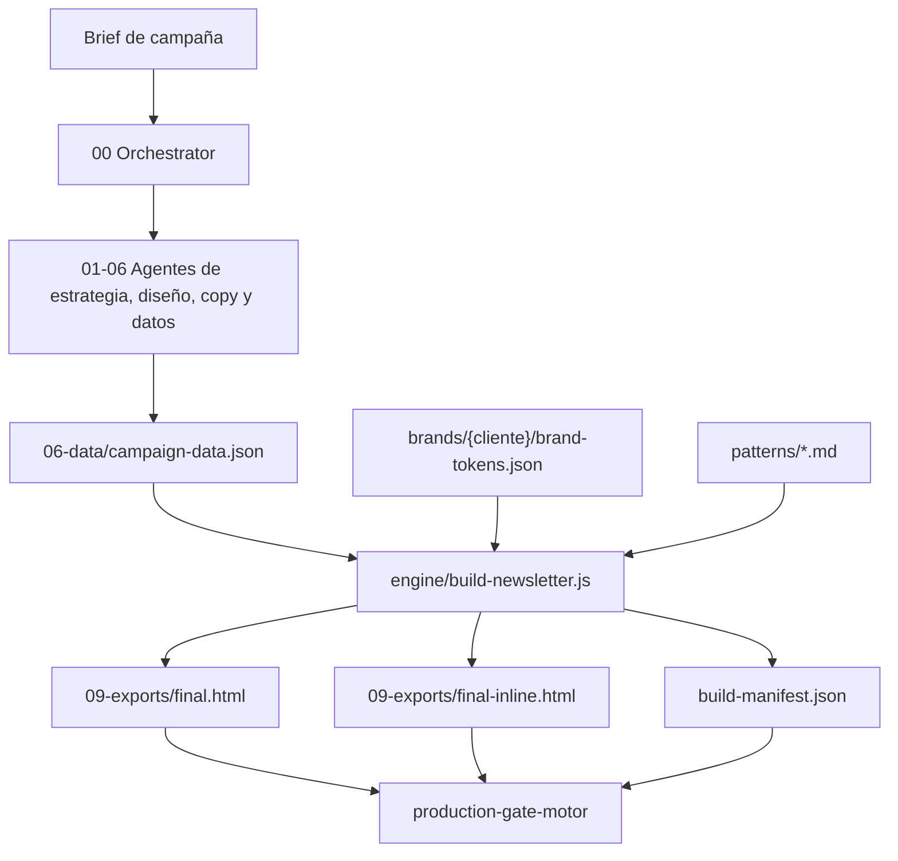

# Hermes Newsletter System

**Versión:** 1.0  
**Fecha:** 2026-07-27  
**Preparado para:** equipo operador de Hermes  
**Dominio:** automatización de producción de newsletters HTML premium

---

## 0. Resumen Ejecutivo

Hermes Newsletter System es un sistema reutilizable para producir newsletters HTML premium a
partir de briefs de campaña, combinando un pipeline de 10 agentes con un motor determinista de
render. El problema que resuelve es doble: reducir la dependencia de edición manual para alcanzar
calidad premium y garantizar que el HTML que se entrega está trazado, validado y alineado con los
datos aprobados. La solución vigente archiva React Email y usa `engine/` para transformar
`campaign-data.json`, brand packs y patrones en `final.html` y `final-inline.html`. El valor
esperado es aumentar velocidad de producción, reducir regresiones, detectar bloqueos antes de
exportación y conservar auditoría por campaña.

## 1. Análisis Funcional Y Requisitos

### 1.1 Contexto Del Negocio

El sistema está pensado para equipos internos que producen campañas CRM/email para múltiples
marcas. Cada campaña requiere mantener identidad visual, copy regulatoriamente seguro, assets
aprobados, enlaces reales, QA responsive y cierre de producción. Antes del motor actual, la
calidad dependía de HTML manual y el gate validaba artefactos que no representaban el envío real.

### 1.2 Actores Del Sistema

| Actor | Descripción | Permisos principales | Frecuencia |
|---|---|---|---|
| Orchestrator | Agente 00 que dirige el pipeline | Activar fases, verificar entregables, bloquear/desbloquear | Por campaña |
| Operador humano | Persona que lanza o revisa Hermes | Dar brief, aprobar decisiones, resolver bloqueos | Por campaña |
| Especialistas 01-09 | Agentes de fase | Crear entregables dentro de su carpeta permitida | Por fase |
| QA | Agente/humano de control visual y técnico | Validar responsive, enlaces, assets, accesibilidad | Por campaña |
| Cliente/stakeholder | Fuente de aprobación externa | Aprobar datos, claims, assets, CTA y producción | Según campaña |
| Motor `engine/` | Sistema determinista no-IA | Generar HTML final y manifest | Por build |

### 1.3 Requisitos Funcionales

| ID | Descripción | Prioridad | Actores |
|---|---|---|---|
| RF-001 | Crear una campaña desde `newsletters/_campaign-template/` con estructura 00-09 | Must | Operador, Orchestrator |
| RF-002 | Generar `06-data/campaign-data.json` válido desde el template | Must | Agente 06 |
| RF-003 | Validar `campaign-data.json` contra `engine/schema/campaign-data.schema.json` | Must | Motor, QA |
| RF-004 | Resolver brand tokens desde `brands/{cliente}/brand-tokens.json` | Must | Motor |
| RF-005 | Validar secuencia de módulos contra el patrón elegido | Must | Agente 03, Motor |
| RF-006 | Ensamblar módulos HTML mediante adaptadores deterministas | Must | Motor |
| RF-007 | Generar `final.html`, `final-inline.html` y `build-manifest.json` | Must | Motor |
| RF-008 | Auditar paridad fuente/inline antes y después de build | Must | QA |
| RF-009 | Ejecutar Gate 0 + Gates 1-11 antes de cierre real | Must | Orchestrator, QA |
| RF-010 | Detectar claims prohibidos o no trazables al brief | Must | Agente 05, Gate |
| RF-011 | Distinguir prueba interna de producción real | Must | QA, Export |
| RF-012 | Mantener `campaign-status.md`, `task-log.md`, `handoff.md`, `next-steps.md` sincronizados | Must | Orchestrator |
| RF-013 | Capturar y validar hero visual de marca cuando aplique | Should | Agente 02, Motor |
| RF-014 | Producir previews responsive para 320/375/600/600-dark | Should | QA |
| RF-015 | Conservar documentación operativa actualizada para agentes | Must | Documenter |

### 1.4 Requisitos No Funcionales

| ID | Categoría | Descripción | Métrica |
|---|---|---|---|
| RNF-001 | Compatibilidad email | HTML compatible con Outlook/Gmail/mobile | Gate sin errores críticos |
| RNF-002 | Trazabilidad | Cada fase deja artefactos y handoff | 4 control files sincronizados |
| RNF-003 | Seguridad | No entregar `.env` ni credenciales | 0 secretos en paquete |
| RNF-004 | Fiabilidad | No escribir outputs parciales | Build aborta antes de escritura |
| RNF-005 | Mantenibilidad | No duplicar pipelines vigentes | React Email archivado |
| RNF-006 | Accesibilidad | Contraste y alt text controlados | `check-contrast` y QA |
| RNF-007 | Reproducibilidad | Misma entrada produce misma salida | manifest con hashes |
| RNF-008 | Testabilidad | Suite de regresión sin red | `npm test` |

### 1.5 Restricciones Y Dependencias

- `node_modules` no forma parte del entregable; debe restaurarse con `npm install`.
- Red/Outlook pueden no estar disponibles en sandbox; esas limitaciones se declaran.
- Los datos de fuentes públicas requieren aprobación del cliente antes de marcarse verificados.
- No se crean patrones ni componentes por anticipación.
- Los documentos históricos no son fuente de verdad operativa.

## 2. Historias De Usuario

### Épica A — Scaffolding Y Datos

**[US-001] Crear campaña base**  
Como operador, quiero crear una campaña desde template para arrancar con estructura auditable.  
**Criterios:** crea 00-09, control files y `campaign-data.json`; no sobrescribe sin `--force`.  
**Estimación:** S. **Prioridad:** Alta. **Dependencias:** Ninguna.

**[US-002] Validar datos de campaña**  
Como agente 06, quiero validar `campaign-data.json` contra schema para evitar builds inválidos.  
**Criterios:** errores de schema claros; placeholders de prueba no pasan como producción.  
**Estimación:** S. **Prioridad:** Alta. **Dependencias:** US-001.

**[US-003] Soportar fallback EACCES**  
Como operador, quiero que `create-campaign` funcione en carpetas montadas aunque `fs.cpSync` falle.  
**Criterios:** fallback manual; log del método usado; campaña válida.  
**Estimación:** S. **Prioridad:** Alta. **Dependencias:** US-001.

### Épica B — Motor De Render

**[US-004] Render determinista**  
Como QA, quiero que el motor genere fuente e inline desde los mismos datos para evitar divergencia.  
**Criterios:** `final.html`, `final-inline.html`, manifest con hashes.  
**Estimación:** M. **Prioridad:** Alta. **Dependencias:** US-002.

**[US-005] Validar patrón**  
Como arquitecto, quiero comprobar que los módulos respetan el patrón de género.  
**Criterios:** orden válido aceptado; módulo obligatorio ausente rechazado.  
**Estimación:** M. **Prioridad:** Alta. **Dependencias:** US-002.

**[US-006] Resolver brand pack**  
Como diseñador, quiero que los tokens de marca se apliquen sin hardcodear estilos por campaña.  
**Criterios:** versión >= 2.2.0; error claro si falta pack o token.  
**Estimación:** M. **Prioridad:** Alta. **Dependencias:** US-002.

### Épica C — QA Y Gate

**[US-007] Ejecutar production gate real**  
Como Orchestrator, quiero un único cierre operativo para no confundir gates legacy con motor.  
**Criterios:** `production-gate` llama a `production-gate-motor`; legacy bajo `legacy:*`.  
**Estimación:** S. **Prioridad:** Alta. **Dependencias:** US-004.

**[US-008] Auditar claims**  
Como responsable legal, quiero detectar copy riesgoso antes de exportación.  
**Criterios:** 29 reglas; severidades; trazabilidad al campo afectado.  
**Estimación:** M. **Prioridad:** Alta. **Dependencias:** US-002.

**[US-009] Auditar assets y placeholders**  
Como QA, quiero diferenciar assets rotos, falta de red y placeholders declarados.  
**Criterios:** warning vs error correcto; producción bloqueada si corresponde.  
**Estimación:** M. **Prioridad:** Alta. **Dependencias:** US-004.

**[US-010] Controlar archivos de estado**  
Como Orchestrator, quiero detectar campañas declaradas completas sin estado auditable.  
**Criterios:** `check-control-files` falla si faltan control files o export real.  
**Estimación:** M. **Prioridad:** Alta. **Dependencias:** US-001.

### Épica D — Operación Multiagente

**[US-011] Mantener contrato por agente**  
Como operador, quiero que cada fase tenga rol y límites claros.  
**Criterios:** `agents/00-09` completos; fronteras respetadas.  
**Estimación:** M. **Prioridad:** Alta. **Dependencias:** Ninguna.

**[US-012] Sincronizar memoria del proyecto**  
Como futuro agente, quiero leer decisiones y gotchas vigentes sin depender del chat.  
**Criterios:** `AGENTS.md`, `context.md`, `memory.md`, `.agent/*` actualizados.  
**Estimación:** S. **Prioridad:** Alta. **Dependencias:** US-011.

**[US-013] Generar reportes y contexto para IA**  
Como operador, quiero documentos canónicos para iniciar nuevas sesiones de IA.  
**Criterios:** contexto y reporte técnico en `docs/`; referencias a comandos vigentes.  
**Estimación:** S. **Prioridad:** Media. **Dependencias:** US-012.

### Épica E — Deuda Técnica Pendiente

**[US-014] Resolver contraste cardLinkSecondary**  
Como QA, quiero que el enlace secundario cumpla WCAG sin degradar marca.  
**Criterios:** `check-contrast` pasa; decisión de diseño documentada.  
**Estado:** Cerrada 2026-07-27 con `colors.primary` en `card-tarifa*`.  
**Estimación:** S. **Prioridad:** Media. **Dependencias:** US-004.

**[US-015] Completar validación de longitud de cierre**  
Como diseñador, quiero bloquear títulos de cierre que rompan layout a 600px.  
**Criterios:** >45 caracteres avisa o falla; <=45 no avisa.  
**Estado:** Cerrada 2026-07-27 en `check-column-balance.ts`.  
**Estimación:** S. **Prioridad:** Media. **Dependencias:** US-004.

## 3. Diseño Técnico Y Propuesta Tecnológica

### 3.1 Arquitectura Del Sistema



### 3.2 Stack Tecnológico Propuesto

| Capa | Tecnología | Justificación |
|---|---|---|
| Orquestación | Markdown agents + Hermes/Claude/Codex | Transparencia y control de fase |
| Motor | Node.js + HTML templates propios | Determinismo y compatibilidad email |
| Schema | JSON Schema + `ajv` | Validación estricta de datos |
| Inline CSS | `juice` | Compatibilidad con clientes de email |
| Testing | `node --test` | Sin dependencia adicional |
| QA visual | Playwright | Capturas responsive |
| Imágenes | Sharp | Procesado de hero/assets |

### 3.3 Modelo De Datos

- Campaign: metadata, settings, brand, pattern, modules.
- Module: `component`, `data`, orden implícito por array y patrón.
- BrandPack: colors, typography, spacing, voice, photography, iconography, version.
- Pattern: sequence grammar, módulos requeridos/opcionales, límites de repetición.
- BuildManifest: hashes, conteos, warnings, patrón, bytes inline.

### 3.4 Diseño De API / CLI Principal

| Comando | Descripción | Requiere dependencias |
|---|---|---|
| `npm run create-campaign -- ...` | Crea campaña desde template | Sí |
| `npm run build-newsletter -- --data ... --out ...` | Renderiza HTML final | Sí |
| `npm run production-gate -- --campaign ...` | Ejecuta cierre real del motor | Sí |
| `npm test` | Suite de regresión | Sí |
| `node scripts/check-engine-integrity.ts` | Verifica lock del motor | No depende de paquetes externos |

### 3.5 Integraciones Externas

- Webs de marca para referencia visual.
- CDN de assets para imágenes finales.
- Plataforma de email marketing destino.
- Herramientas de IA que ejecutan agentes y actualizan artefactos.

### 3.6 Seguridad Y Privacidad

No se deben entregar secretos, `.env` ni `node_modules`. Las campañas deben incluir enlaces de
baja/preferencias cuando aplique. Los claims sensibles se bloquean si no están trazados al brief.
Los datos públicos se consideran pendientes de aprobación cliente.

### 3.7 Estimación De Esfuerzo

| Fase | Descripción | Duración estimada | Entregables |
|---|---|---|---|
| F0-F5 | Transformación React Email -> motor | Cerrada | Engine, agentes, gates, prueba real |
| F1 deuda | Fiabilidad y tests | Cerrada 2026-07-27 | fallback EACCES, `npm test` |
| F2 deuda | Refinamiento visual/contenido | Parcialmente cerrada | contraste, validación 45 chars y bug histórico cerrados; `card-tarifa-2` bloqueado |
| Producción real | Primera campaña aprobada cliente | Según campaña | Gate 0 + Gates 1-11 en verde |

## 4. Plan De Pruebas

### 4.1 Estrategia

Combinar tests unitarios del motor, smoke test end-to-end, integridad de motor, gates por campaña
y QA visual. La suite no debe depender de red ni de campañas reales.

### 4.2 Tipos De Prueba

| Tipo | Herramientas | Cobertura objetivo | Responsable |
|---|---|---|---|
| Unitarias | `node --test` | Tokens, patrones, adaptadores | Dev |
| Smoke | `node --test` + build engine | Ejemplo schema | Dev |
| Integridad | `check-engine-integrity.ts` | Componentes y lock | Dev/QA |
| Gate | `production-gate-motor` | Campaña completa | QA |
| Visual | Playwright | 320/375/600/600-dark | QA |

### 4.3 Escenarios Gherkin

```gherkin
Feature: Creacion de campaña
  Scenario: Crear campaña valida desde template
    Given el template contiene 06-data/campaign-data.json
    When ejecuto create-campaign con year, client y campaign
    Then la campaña se crea con carpetas 00-09
    And campaign-data.json valida contra schema

  Scenario: Fallback por EACCES
    Given fs.cpSync falla con EACCES
    When ejecuto create-campaign
    Then el script usa copia recursiva manual
    And la campaña se crea sin abortar

  Scenario: Rechazar sobrescritura sin force
    Given ya existe newsletters/2026/demo/2026-jul-demo
    When ejecuto create-campaign con el mismo slug sin --force
    Then el comando termina con error
    And no modifica los archivos existentes

  Scenario: Detectar JSON de campaña invalido
    Given campaign-data.json no cumple el schema del motor
    When ejecuto la validacion del scaffold
    Then el error indica el campo invalido
    And la campaña no puede avanzar a build
```

```gherkin
Feature: Build del motor
  Scenario: Render end-to-end desde datos validos
    Given existe un campaign-data.json valido
    When ejecuto engine/build-newsletter.js
    Then se generan final.html, final-inline.html y build-manifest.json
    And el manifest no contiene errores de verificacion

  Scenario: Pattern invalido
    Given campaign-data.json omite un modulo obligatorio
    When ejecuto el build
    Then el build falla antes de escribir outputs finales

  Scenario: Rechazar forma antigua de modulo
    Given campaign-data.json contiene modulos con forma {type, content}
    When ejecuto engine/build-newsletter.js
    Then la validacion de schema falla
    And el motor no genera final.html

  Scenario: Brand pack con version insuficiente
    Given el brand pack tiene version menor que 2.2.0
    When el motor intenta cargar tokens
    Then el build falla con un mensaje claro
```

```gherkin
Feature: Cierre de produccion
  Scenario: Gate real del motor
    Given una campaña tiene exports generados por engine
    When ejecuto npm run production-gate
    Then se ejecuta production-gate-motor
    And solo exit 0 permite candidatura a produccion

  Scenario: Bloquear campaña completed sin control files
    Given campaign-status.md declara estado completed
    And falta task-log.md o handoff.md
    When se ejecuta check-control-files
    Then el gate falla
    And el reporte identifica el archivo faltante

  Scenario: Detectar claim comercial prohibido
    Given campaign-data.json contiene un claim de ahorro no aprobado
    When se ejecuta el gate de claims
    Then el resultado contiene error de severidad alta
    And la campaña no puede ser candidata a produccion

  Scenario Outline: Placeholders segun modo de campaña
    Given una campaña con isTestCampaign <modo>
    And contiene URL placeholder
    When ejecuto production-readiness
    Then el resultado es <resultado>

    Examples:
      | modo  | resultado             |
      | true  | warning de prueba     |
      | false | error bloqueante      |
```

## 5. Riesgos Y Plan De Contingencia

| ID | Riesgo | Probabilidad | Impacto | Mitigación |
|---|---|---|---|---|
| R-001 | Docs históricas confunden a agentes | Media | Alto | `AGENTS.md`, `.agent/*` y prompt Hermes como fuente viva |
| R-002 | Cliente no aprueba datos/claims | Media | Alto | bloquear producción y registrar en `next-steps.md` |
| R-003 | Dependencias ausentes tras limpieza | Alta | Medio | documentar `npm install` antes de tests/gates |
| R-004 | Se toca engine sin actualizar lock | Media | Alto | Gate 0 y `check-engine` |
| R-005 | QA visual limitado por sandbox | Media | Medio | declarar limitación y ejecutar en entorno con navegador completo |

## 6. Próximos Pasos Recomendados

1. Esperar una campaña real que necesite exactamente 2 tarjetas antes de crear `card-tarifa-2`.
2. Ejecutar una campaña real con aprobación cliente completa.
3. Cerrar con `npm run production-gate -- --campaign ...`.
4. Actualizar `memory.md` tras el primer envío real aprobado.
